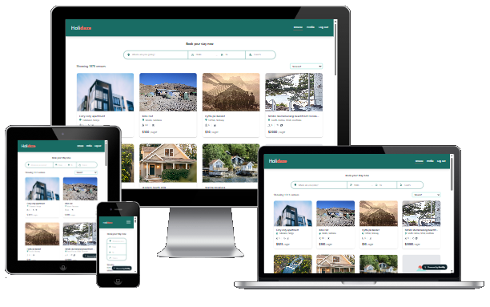

# Holidaze

Holidaze is a booking site built during an exam project at Noroff.
Customers can browse venues, check availability and book stays. Venue managers
can create and manage their own venues and see upcoming bookings for them.

- **Live site:** https://holidaz3.netlify.app/
- **Repository:** https://github.com/evrlong/holidaze



## Features

### All visitors

- Browse venues
- Search and filter by location (city), check-in/check-out dates and number of guests
- View a single venue with images, amenities, description, host and an
  availability calendar
- FAQ, contact and terms pages

### Customers (registered users)

- Register and login with a `@stud.noroff.no` email
- Book a venue: choose dates and how many guests, and you see the total price
  before you book
- See and cancel your upcoming bookings in **Profile → Bookings**
- Edit your profile and avatar

### Venue managers

- Register as venue manager by check the venue manager box when you sign up
- List, edit and delete venues in **Profile → Venues**
- See the upcoming bookings for each venue

## Tech stack

| Area                | Tool                                                                        |
| ------------------- | --------------------------------------------------------------------------- |
| Framework           | React 19 + TypeScript                                                       |
| Build tool          | Vite                                                                        |
| Styling             | Tailwind CSS                                                                |
| Routing             | React Router                                                                |
| Server state        | TanStack Query                                                              |
| Client state (auth) | Zustand                                                                     |
| Calendar            | react-day-picker + date-fns                                                 |
| Icons               | react-icons                                                                 |
| Code quality        | ESLint + Prettier                                                           |
| Hosting             | Netlify                                                                     |
| API                 | [Noroff API v2 – Holidaze](https://docs.noroff.dev/docs/v2/holidaze/venues) |

## Getting started

### What you need

- [Node.js](https://nodejs.org/) 20.19+ or 22.12+ (required by Vite)
- npm
- A Noroff API key. See [how to get one](https://docs.noroff.dev/docs/v2/auth/api-key).

### Installation

1. Clone the repository:

   ```bash
   git clone https://github.com/evrlong/holidaze.git
   cd holidaze
   ```

2. Install dependencies:

   ```bash
   npm install
   ```

3. Create a `.env` in the project root with your API key:

   ```env
   VITE_NOROFF_API_KEY=your-api-key
   ```

   The `.env` file is git-ignored and is **not** included in the repository.
   Without it, all requests that need authentication (booking, profile, venue
   management) will fail.

4. Start the development server:

   ```bash
   npm run dev
   ```

   Open http://localhost:5173 in your browser.

### Production build

```bash
npm run build
npm run preview
```

## Available scripts

| Command                | Description                                    |
| ---------------------- | ---------------------------------------------- |
| `npm run dev`          | Start the development server                   |
| `npm run build`        | Type-check and build for production to `dist/` |
| `npm run preview`      | Preview the production build locally           |
| `npm run typecheck`    | Run the TypeScript compiler without emitting   |
| `npm run lint`         | Run ESLint                                     |
| `npm run format`       | Format all files with Prettier                 |
| `npm run format:check` | Check formatting without writing changes       |

## Project structure

```
src/
├── components/     Shared layout and UI components (Layout, Toast, ConfirmDialog …)
├── context/        React context (toast notifications)
├── features/       Feature modules, each with its own api.ts, hooks and types
│   ├── auth/
│   ├── bookingSystem/
│   ├── myBookings/
│   ├── profile/
│   └── venues/
├── lib/            Constants (API base URL, API key) and shared types
├── pages/          Route-level pages
├── utils/          Helpers (form validation, booked date ranges)
├── index.css       Tailwind import, theme colors and calendar styling
├── main.tsx        App entry point
└── router.tsx      Route definitions
```


### Good to know

- **Two roles = two accounts.** Venue manager status is chosen at
  registration. To test both customer and manager features, use two accounts or edit venue manager status
- **Calendar.** Past dates and already booked dates are disabled. Booked
  dates are shown with a red strikethrough. A selected range cannot span a
  booked period.
- **Shared API.** The Noroff API is shared by all students, so you will see
  venues and bookings created by other users, and some may have incomplete data
  or broken images (a placeholder image is shown instead).
- **Light mode only.** The site is locked to light mode, so browsers that
  force dark mode should not change its colors.


### Test flow

1. **Customer:** Register or log in, search for a venue, pick dates and
   2 guests, and reserve. Check that the booking appears under
   **Profile → Bookings**.
2. Open the same venue again and check that the booked dates are now disabled.
3. Cancel the booking from **Profile → Bookings**.
4. **Venue manager:** Log in as a manager, create a venue, edit it, and check
   that bookings on it show up under **Profile → Venues**.
5. Delete the test venue.
6. Resize the browser or use device emulation to check the layout on mobile,
   tablet and desktop.

### Known limitations

- Ratings are not shown, because the project has no rating system.
- Location autocomplete was removed because it froze on several devices, ans contained too many test locations. 

## Deployment

The site is deployed on Netlify:

- Build command: `npm run build`
- Publish directory: `dist`
- Environment variable: `VITE_NOROFF_API_KEY` must be set in the Netlify site
  settings

## Links


- Figma design: 
- Kanban board:
- Style guide:

## Author

[evrlong](https://github.com/evrlong)
